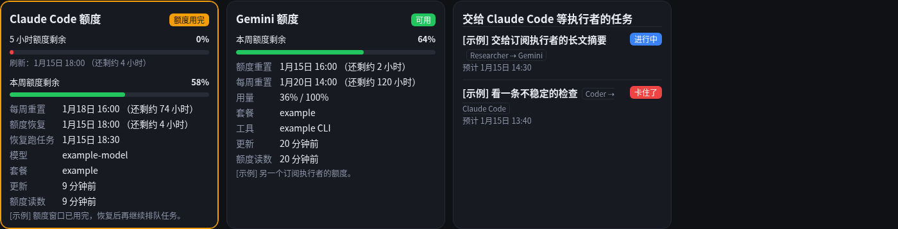

# GrokBot Task Dashboard

[中文说明](README.zh-CN.md)

A small status board for work that is split across bots or agents. A stdlib-only Python CLI (`st`) records each task locally, and a Cloudflare Pages site shows the latest snapshot.


The cards above are **example data** (Coordinator, Researcher, Coder, Ops, Writer). The yellow banner on that page says so. Nothing in the picture is a live task.

## What it records

Each task has a stable id, title, type, state, percent, stage, note, and an ETA. When it finishes, `st` keeps:

- the **original** duration (`--estimate`, or the first ETA minus the start)
- the **actual** duration (finish minus first start). It is wall-clock time, so time spent `waiting` or blocked on quota counts too; moving back from `waiting` to `running` does not restart the clock
- how many times the ETA was revised

Cancelled tasks stay in the recent list and are left out of the ratios. The on-screen "recently finished" list defaults to 7 days (`ST_HISTORY_DAYS`). Calibration uses a longer window, 90 days by default (`ST_STATS_DAYS`).

## ETA calibration

For every completed task with both durations, the ratio is `actual / estimate`. Greater than 1 means the work ran long. Per bot, per task type, and per pair, `st` keeps:

- sample count
- median ratio, 25th and 75th percentiles, and the spread between those two
- overrun rate (share of ratios above 1)
- median ETA revision count

On `st set` and `st estimate`, a new duration is turned into a point estimate and a range:

1. Use the most specific bucket that has at least `ST_CALIBRATE_MIN` samples (default 3): this bot and this type, then this type, then this bot, then everything in the window.
2. Point estimate = raw duration × median ratio. Range = raw duration × [p25, p75].
3. With only one or two samples, the median is shrunk toward 1 and the range is widened toward 0.5×–2×. The line says the confidence is low.
4. With no usable history, the raw duration is kept and the reference range is 0.5×–2×.

The original estimate is never replaced by the suggestion. That is what later tasks are scored against. The dashboard repeats the same numbers: a table per bot and per type, and the calibrated range on each active card.


English UI (same example payload, language toggle):


A narrow viewport:


## CLI

```bash
chmod +x cli/st
export PATH="$PWD/cli:$PATH"
export ST_ROOT="$HOME/.grokbot-task-dashboard"   # default if unset
export ST_LANG=zh                                 # or en
# export ST_PUSH_URL=https://YOUR_DOMAIN/api/push  # after you deploy
```

```bash
st set --bot Coder --task-id parse-durations --task-type coding \
  --title "解析工期" --stage "相对时间" --pct 20 --estimate 2h --eta +2h

st set --bot Coder --task-id parse-durations --pct 60 --stage "绝对时间" --eta +90m

st estimate --bot Coder --task-type coding --estimate 2h

st list
st stats
st done --bot Coder --task-id parse-durations
st rm --bot Coder --task-id parse-durations          # mistaken entry, not history
st claude --state quota --reset +5h --resume +5h30m --note "额度用完"
st claude --session-left 40 --week-left 70 --weekly-reset "01-20 10:00"
scripts/claude-usage.sh                              # read /usage, then st claude --from-usage
st quota --runner Gemini --state ok --week-left 64 --reset +3h
st beat --bot Coder --task-id parse-durations --watcher tests  # heartbeat only
stwatch start --name tests --bot Coder --task-id parse-durations -- ./watch-tests.sh
st push
st token-sha256                                      # hash only, for the Pages secret
```

ETA forms: `2026-10-18 03:30`, `03:30` (today, or tomorrow if that clock time has passed), `10-19 03:30`, `+45m`, `+2h`, `+1d`, or `待估` / `unknown`. Times are interpreted in `ST_TZ` (default `America/New_York`).

`ST_BOTS` overrides the built-in roster (`Name:description` pairs, comma-separated). Bots that are not listed still show up once they have a state file. States: `running`, `waiting`, `queued`, `blocked`, `quota`, `routine`, `done`, `cancelled`.

Local files live under `$ST_ROOT`: `bots/<name>.json`, `.token`, `.lock`, `.push_pending`, and `watchers/` for `stwatch`. A failed push is retried with backoff (`ST_PUSH_RETRIES` total attempts, default 2; 401/403 are not retried). Writes take an exclusive file lock. The push posts one JSON snapshot to `ST_PUSH_URL` with `Authorization: Bearer`. If the URL or the token file is missing, the local write still stands.

Reporting habits for agents: [docs/agent-reporting.md](docs/agent-reporting.md)（[中文](docs/agent-reporting.zh-CN.md)）.

## Dashboard

`site/public` is the static page. `site/functions` is the Pages side:

- `_middleware.js` requires a Cloudflare Access JWT for every path except `/api/push`. Team domain, audience, and email allowlist come from `env` (`ACCESS_TEAM_DOMAIN`, `ACCESS_AUD`, `ACCESS_ALLOWED_EMAILS`).
- `POST /api/push` checks the bearer token against `env.TOKEN_SHA256` and stores the snapshot in D1 (`env.DB`).
- `GET /api/state` returns that snapshot. The page polls it every 60 seconds.

Open `site/public/index.html` through any static server with `?example=1` to render `example-state.json` without Cloudflare. The button in the header switches the UI between 中文 and English. Running tasks that go quiet get a "maybe stuck" or "lost" badge (see [agent-reporting.md](docs/agent-reporting.md#stuck-and-lost-tasks)); tasks run under `stwatch` show their watcher and heartbeat. Click a state chip or badge to filter the board (the filter is kept in the URL as `#f=STATE`). Quota cards show Claude Code's 5-hour and weekly bars and one card per `st quota` runner; tasks whose `--via` names a runner follow its quota (running → quota while it is out, quota → queued after its reset).



## Deploy

From an empty Cloudflare account: [docs/deploy.md](docs/deploy.md)（[中文](docs/deploy.zh-CN.md)）. The short version is: create a D1 database, apply `site/schema.sql`, create a Pages project, bind the database as `DB`, put Access in front of the hostname (and the preview wildcard) with a bypass only for `/api/push`, store the SHA-256 of the push token as the `TOKEN_SHA256` secret, then `./site/deploy.sh`.

## Development

```bash
make test
python3 scripts/build_example_state.py   # refresh the labeled example snapshot
```

Python tests cover time parsing, state transitions, and the calibration math (`unittest`, no extra packages). JavaScript tests cover push-token hashing and the calibration lines the page renders (`node:test`). GitHub Actions runs both on Python 3.11–3.13. `st` needs macOS or Linux (it uses `fcntl`); on Windows use WSL.

The privacy test and `scripts/scan-history.sh` read the terms to look for from an uncommitted `.privacy-terms` file (one per line, gitignored; see `.privacy-terms.example`) or from `PRIVACY_TERMS` (comma-separated). Without either, the test is skipped and the script exits 2, so the list of what to hide never ships in the repo.

Screenshots are produced from the example snapshot. If Playwright is installed somewhere other than `node_modules`, point `PLAYWRIGHT_MODULE` at its entry file (for example `PLAYWRIGHT_MODULE=/path/to/node_modules/playwright/index.mjs`).

```bash
npm install playwright && npx playwright install chromium
node scripts/screenshot.mjs
```

## Privacy

Config that identifies an account (Pages project, D1 id, Access audience, team domain, allowlist, push token) is environment or dashboard state, not source. The repo's `.gitignore` covers `.token`, `.env`, `.dev.vars`, `.wrangler/`, `node_modules/`, and local `bots/` state. Ship the hash of the push token, never the token. Example bots and tasks are marked example in the JSON and on the page.

## License

[MIT](LICENSE). Copyright (c) 2026 GrokBot Task Dashboard contributors.
