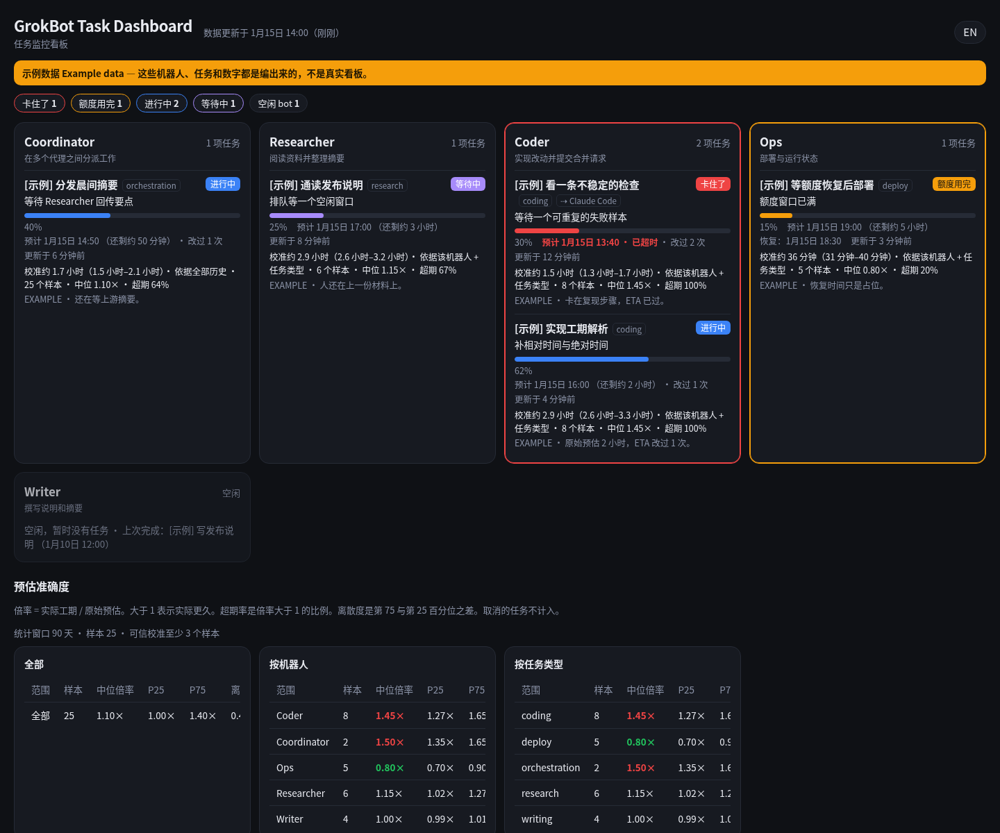
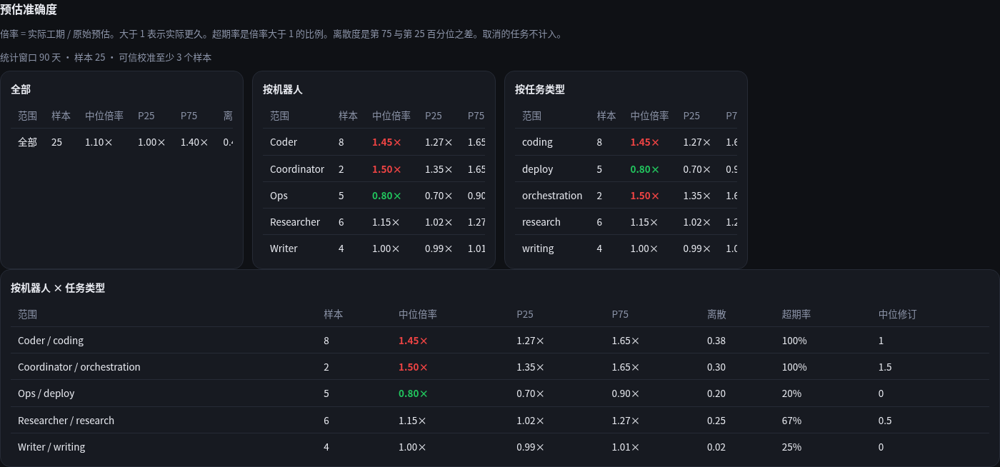
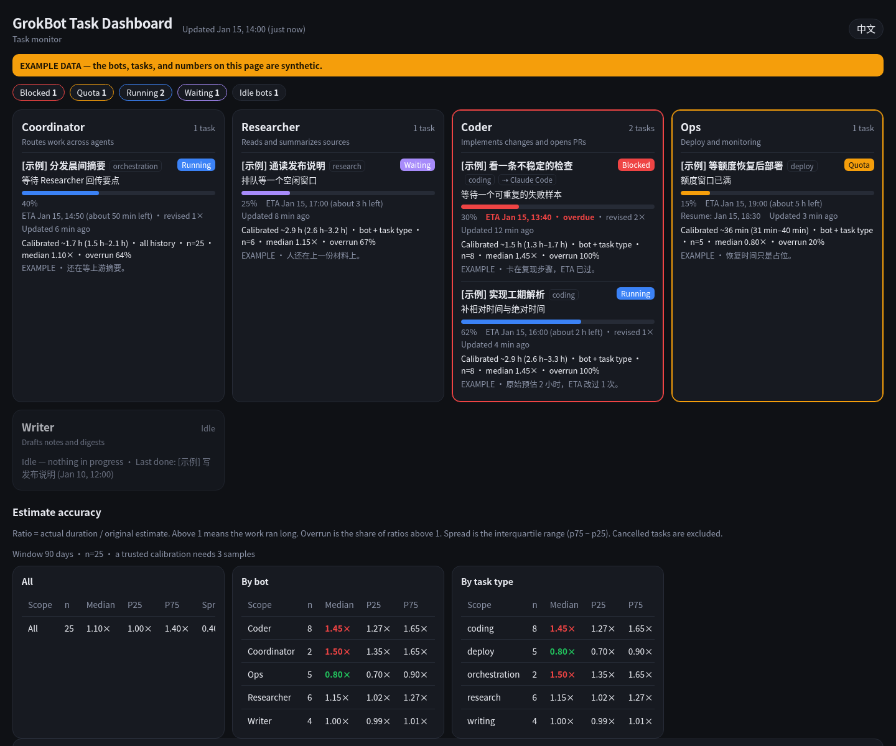
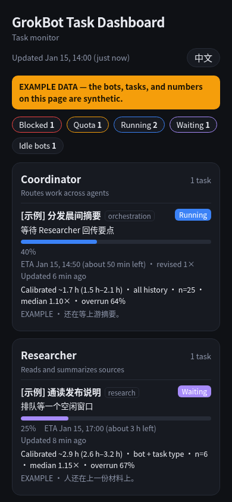

# GrokBot 任务监控看板

[English](README.md)

一个给拆在多个机器人（或代理）上的工作用的状态板。命令行 `st` 只用 Python 标准库，把每条任务记在本地；Cloudflare Pages 上的页面显示最新的一份快照。



上面这些卡片是**示例数据**（Coordinator、Researcher、Coder、Ops、Writer）。页面上的黄色横幅会写明这一点。图里没有真实任务。

## 记了什么

每条任务有稳定 id、标题、类型、状态、百分比、步骤、备注和 ETA。完成时 `st` 会留下：

- **原始**工期（`--estimate`，或第一次 ETA 减去开始时间）
- **实际**工期（完成时间减去首次开始时间）。按墙钟计算，`waiting` 和等额度的时间也算在内；从 `waiting` 改回 `running` 不会重新计时
- ETA 被改过几次

取消的任务还在「最近完成」里，但不进入倍率。看板上的最近完成默认是 7 天（`ST_HISTORY_DAYS`）。校准用更长的窗口，默认 90 天（`ST_STATS_DAYS`）。

## ETA 校准

每条同时有原始工期和实际工期的已完成任务，倍率是 `实际 / 原始预估`。大于 1 表示实际更久。按机器人、按任务类型、按两者的组合，`st` 统计：

- 样本数
- 中位倍率、第 25 与第 75 百分位，以及两者之差（离散度）
- 超期率（倍率大于 1 的比例）
- ETA 修订次数的中位数

`st set` 和 `st estimate` 会把一段新的工期变成一个点估计和一个区间：

1. 选用样本数达到 `ST_CALIBRATE_MIN`（默认 3）的最具体分组：这个机器人加这个类型，然后这个类型，然后这个机器人，最后是窗口内的全部样本。
2. 点估计 = 原始工期 × 中位倍率。区间 = 原始工期 × [p25, p75]。
3. 只有一两个样本时，中位倍率会往 1 收缩，区间会向 0.5×–2× 张开，并标明置信度低。
4. 没有可用历史时，保留原始工期，参考区间是 0.5×–2×。

建议不会覆盖原始预估。以后的任务拿来对照的就是这个原始数字。看板用同一套数字：按机器人和按类型各一张表，进行中的卡片上会写出校准区间。



英文界面（同一份示例数据，用页头的语言开关切换）：



窄屏：



## 命令行

```bash
chmod +x cli/st
export PATH="$PWD/cli:$PATH"
export ST_ROOT="$HOME/.grokbot-task-dashboard"   # 不设的话这就是默认值
export ST_LANG=zh                                 # 或 en
# export ST_PUSH_URL=https://YOUR_DOMAIN/api/push  # 部署之后再设
```

```bash
st set --bot Coder --task-id parse-durations --task-type coding \
  --title "解析工期" --stage "相对时间" --pct 20 --estimate 2h --eta +2h

st set --bot Coder --task-id parse-durations --pct 60 --stage "绝对时间" --eta +90m

st estimate --bot Coder --task-type coding --estimate 2h

st list
st stats
st done --bot Coder --task-id parse-durations
st rm --bot Coder --task-id parse-durations          # 登记错了，不进历史
st claude --state quota --reset +5h --resume +5h30m --note "额度用完"
st push
st token-sha256                                      # 只打印哈希，用来填 Pages 机密
```

ETA 可以写成：`2026-10-18 03:30`、`03:30`（今天，若已过则是明天）、`10-19 03:30`、`+45m`、`+2h`、`+1d`，或 `待估` / `unknown`。时间按 `ST_TZ` 解释，默认 `America/New_York`。

`ST_BOTS` 可以覆盖内置名单（`名字:简介`，用英文逗号分开）。没写进名单的机器人，一旦有了状态文件也会出现。状态：`running`、`waiting`、`queued`、`blocked`、`quota`、`routine`、`done`、`cancelled`。

本地文件在 `$ST_ROOT`：`bots/<名字>.json`、`.token`、`.lock`、`.push_pending`。写入时会加文件锁。推送把一整份 JSON 快照 POST 到 `ST_PUSH_URL`，头是 `Authorization: Bearer`。没有地址或没有令牌文件时，本地记录仍然保存。

给代理的上报习惯：[docs/agent-reporting.zh-CN.md](docs/agent-reporting.zh-CN.md)（[English](docs/agent-reporting.md)）。

## 看板

`site/public` 是静态页。`site/functions` 是 Pages 侧：

- `_middleware.js` 除了 `/api/push` 以外都要 Cloudflare Access 的 JWT。团队域名、受众和邮箱白名单来自 `env`（`ACCESS_TEAM_DOMAIN`、`ACCESS_AUD`、`ACCESS_ALLOWED_EMAILS`）。
- `POST /api/push` 用 `env.TOKEN_SHA256` 核对 Bearer 令牌，把快照写进 D1（`env.DB`）。
- `GET /api/state` 返回这份快照。页面每 60 秒拉一次。

不连 Cloudflare 时，用任意静态服务器打开 `site/public/index.html` 并加上 `?example=1`，就会渲染 `example-state.json`。页头的按钮在中文和 English 之间切换。

## 部署

从空的 Cloudflare 账号开始：[docs/deploy.zh-CN.md](docs/deploy.zh-CN.md)（[English](docs/deploy.md)）。简要步骤：创建 D1 并执行 `site/schema.sql`，创建 Pages 项目，把数据库绑定为 `DB`，用 Access 保护主机名和预览域名，只对 `/api/push` 做绕过，把推送令牌的 SHA-256 存成机密 `TOKEN_SHA256`，然后运行 `./site/deploy.sh`。

## 开发

```bash
make test
python3 scripts/build_example_state.py   # 重新生成标明为示例的快照
```

Python 测试覆盖时间解析、状态流转和校准数学（`unittest`，没有额外依赖）。JavaScript 测试覆盖推送令牌哈希，以及页面上的校准文案（`node:test`）。GitHub Actions 会在 Python 3.11–3.13 上跑这两边。`st` 需要 macOS 或 Linux（用到 `fcntl`），Windows 上请用 WSL。

隐私测试和 `scripts/scan-history.sh` 要查的词从未提交的 `.privacy-terms` 文件读取（每行一个，已被 git 忽略，格式见 `.privacy-terms.example`），也可以用 `PRIVACY_TERMS`（逗号分隔）。两者都没有时测试跳过、脚本以 2 退出，所以「要隐藏什么」这份清单本身不会进仓库。

截图来自示例快照。如果 Playwright 没装在本仓库的 `node_modules` 里，用 `PLAYWRIGHT_MODULE` 指向它的入口文件（例如 `PLAYWRIGHT_MODULE=/path/to/node_modules/playwright/index.mjs`）。

```bash
npm install playwright && npx playwright install chromium
node scripts/screenshot.mjs
```

## 隐私

能对应到某个账号的配置（Pages 项目、D1 id、Access 受众、团队域名、白名单、推送令牌）放在环境变量或 Cloudflare 控制台里，不放进源码。`.gitignore` 已包含 `.token`、`.env`、`.dev.vars`、`.wrangler/`、`node_modules/` 和本地的 `bots/`。提交的是令牌的哈希，不是令牌本身。示例机器人和示例任务在 JSON 里和页面上都标了 example。

## 许可证

[MIT](LICENSE)。Copyright (c) 2026 GrokBot Task Dashboard contributors.
